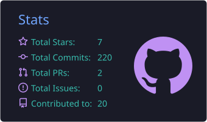
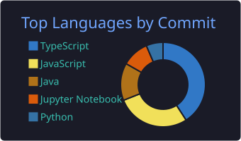

<h1 align="center">Vishal R Naik</h1>

<b>Full-stack · Systems · Machine Learning</b> 
Final-year CS @ KLE Technological University, Hubballi

  
  
  

---

## 👋 About

I build things end to end and care about the parts where design choices show up in numbers: latency, throughput and failure modes. I've shipped a deployed multi-vendor marketplace with ML features, written a C++17 HTTP server from scratch, and built ML systems for research problems.

**Looking for:** a hands-on engineering internship (backend, full-stack or applied ML) with a small team where I can ship real features from day one.

## ⚡ Highlights

- 🛒 **Deligo** is live at [deligo.live](https://deligo.live): Next.js + MongoDB, **80+ API endpoints**, ML-powered search, recommendations and chatbot
- 🚀 **Titan**, an HTTP server in C++17, runs at **~77K req/s**
- 🏆 **WiDS Datathon 2025**: top 18 of 1000+ teams
- 🔬 **Research:** few-shot fashion recognition (ConvNeXt-Tiny + Prototypical Networks)

---

## 🔥 Featured projects

### 🛒 [Deligo](https://github.com/VISHAL-Nk/deligo): multi-vendor e-commerce platform · [live](https://deligo.live)
Full-stack marketplace with 80+ API endpoints, plus an AI layer:
- **Demand forecasting** with XGBoost
- **RAG chatbot** for customer questions
- **Fast search** with Meilisearch
- Recommendations, a seller assistant and AR preview as part of the AI architecture

    

### ⚡ [Titan](https://github.com/VISHAL-Nk/Titan): C++17 HTTP server
Built from scratch to understand what happens between the socket and the response. Benchmarked at **~77K requests/second**, with the method and numbers in the repo.

 

### 📡 [5G Interface Monitoring (MCP)](https://github.com/VISHAL-Nk/MCP-Based-Intelligent-Interface-Monitoring-and-Failure-Detection-in-5G-Wireless-Networks)
MCP-based system that monitors 5G network interfaces, scans packets and detects connection failures. Presented as a seminar with a live demo.

 

### 👗 [Few-shot Fashion Category Recognition](https://github.com/VISHAL-Nk/Few-shot-Fashion-Category-Recognition-in-Emerging-Apparel-Markets)
Research on recognising fashion categories from very few labelled examples in emerging apparel markets. ConvNeXt-Tiny backbone, Prototypical Networks, Part-Aware Pooling, trained on DeepFashion2.

 

### More
[Demand Prediction](https://github.com/VISHAL-Nk/demand-prediction) · [Chatbot Server](https://github.com/VISHAL-Nk/Chatbot-server) · [WiDS Datathon 2025](https://github.com/VISHAL-Nk/WIDS_Datathon-2025)

---

## 🧰 Stack

     
    
     

---

## 📊 GitHub

  
  

<i>Let's build something together, reach out above. 🚀</i>

